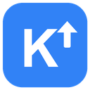
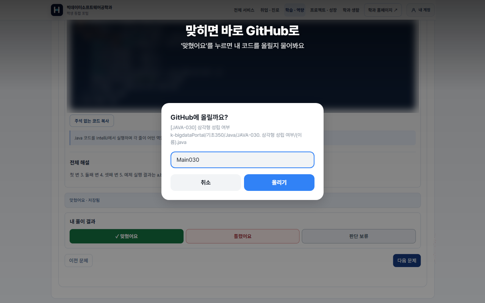
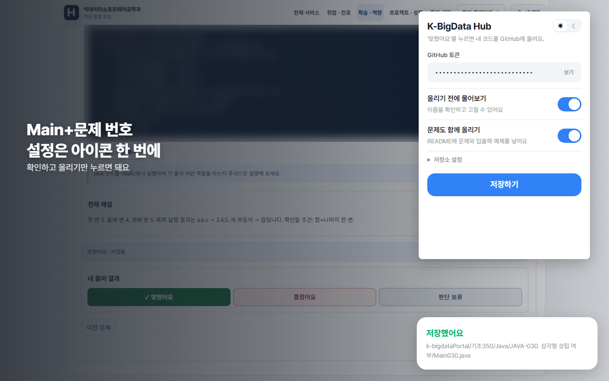

<div align="center">



# K-BigData Hub

**"맞혔어요"를 누르면 내 풀이가 GitHub에 올라갑니다.**

학과 코딩 포털의 문제 풀이를 내 저장소에 바로 쌓아 주는 크롬 확장프로그램




</div>

> 빅데이터소프트웨어공학과 학생 통합 포털(`portal.k-bigdata.kr`)에서만 동작합니다. 포털은 학생 로그인이 필요합니다.

## 이렇게 동작해요

1. 포털에서 문제를 풀고 **맞혔어요**를 누릅니다.
2. 확인 창에서 파일 이름을 보고 **올리기**를 누릅니다.
3. 코드와 README가 **커밋 하나로** 내 저장소에 올라갑니다.

```text
k-bigdataPortal/
├─ 기초350/
│  ├─ Java/
│  │  └─ JAVA-030. 삼각형 성립 여부/
│  │     ├─ Main030.java
│  │     └─ README.md
│  ├─ C/ · Python/ · Ubuntu/
└─ 정보처리실기/
   └─ SQL/
```

## 지원하는 문제

| 문제 | 올라가나요 |
|---|---|
| 기초 코딩 350제 (Java · C · Python · Ubuntu) | ✅ 언어별 폴더 |
| 정보처리 실기 — SQL 작성 | ✅ `정보처리실기/SQL/` |
| 정보처리 실기 — 답만 적는 문제 (실행결과, 빈칸 등) | ❌ 올리지 않는다고 알려 줍니다 |

## 기능

- 내가 작성한 코드만 올립니다. **정답 코드와 해설은 올리지 않습니다.**
- 같은 문제를 다시 풀면 같은 파일을 덮어쓰고, 내용이 같으면 빈 커밋을 만들지 않습니다.
- Java는 클래스 이름을 파일 이름에 맞춰 줍니다. (`Main` → `Main030`)
- 올리기에 실패하면 알림 카드의 **다시 올리기**로 바로 다시 시도합니다.
- 확인 창 켜기·끄기, 문제 함께 올리기 켜기·끄기, 저장소·브랜치·폴더 설정, 라이트·다크 테마

<div align="center">

</div>

## 설치

> 크롬 웹 스토어 심사 중입니다. 그동안은 아래처럼 직접 불러올 수 있습니다.

1. 이 페이지의 **Code → Download ZIP**을 눌러 받고, 압축을 풉니다.
2. 크롬 주소창에 `chrome://extensions`를 입력합니다.
3. 오른쪽 위 **개발자 모드**를 켭니다.
4. **압축해제된 확장 프로그램을 로드합니다**를 눌러 `manifest.json`이 있는 폴더를 고릅니다.

불러온 폴더는 지우거나 옮기지 마세요. 직접 불러온 확장은 자동으로 업데이트되지 않습니다. 새 버전은 같은 폴더에 덮어쓴 뒤 확장 관리 화면에서 새로고침합니다.

## 처음 설정

1. 풀이를 올릴 저장소를 만듭니다.
2. [Fine-grained 토큰](https://github.com/settings/personal-access-tokens/new?name=K-BigData+Hub&contents=write)을 만듭니다.
   - **Repository access:** Only select repositories → 위 저장소 하나
   - **Permissions:** Contents → **Read and write**
3. 툴바의 K-BigData Hub 아이콘을 눌러 토큰과 `아이디/저장소`를 넣고 **저장하기**를 누릅니다.
4. 열려 있던 포털 탭을 새로고침합니다.

| 알림에 보이는 번호 | 확인할 것 |
|---|---|
| 401 | 토큰이 틀렸거나 만료됨 |
| 403 | 토큰의 Contents 권한이 Read and write인지 |
| 404 | 저장소 이름, 토큰에서 고른 저장소 |

## 개인정보와 권한

- 토큰과 설정은 **내 브라우저에만** 저장하고, GitHub 말고는 어디에도 보내지 않습니다.
- 권한은 `storage`와 `api.github.com` 접속뿐입니다.
- 자세한 내용: [개인정보처리방침](store/PRIVACY.md)

토큰은 비밀번호와 같습니다. 실습실 같은 공용 PC에서는 다 쓴 뒤 토큰 칸을 지우고 저장해 주세요.

공개 저장소에 올리면 코드와 문제 문장을 누구나 볼 수 있습니다. 숨기려면 비공개 저장소를 쓰거나 "문제도 함께 올리기"를 끄세요.

## 개발

빌드 과정과 외부 라이브러리가 없습니다.

| 파일 | 역할 |
|---|---|
| `content.js` | 포털에서 "맞혔어요"를 감지하고 확인 창·알림을 띄움 |
| `background.js` | GitHub API로 커밋 |
| `lib.js` | 파일 이름·폴더·README 규칙 |
| `options.html`, `options.js` | 설정 창 |

```bash
node test.js
```

글꼴은 [Pretendard](fonts/LICENSE.txt)(SIL Open Font License)를 씁니다.
